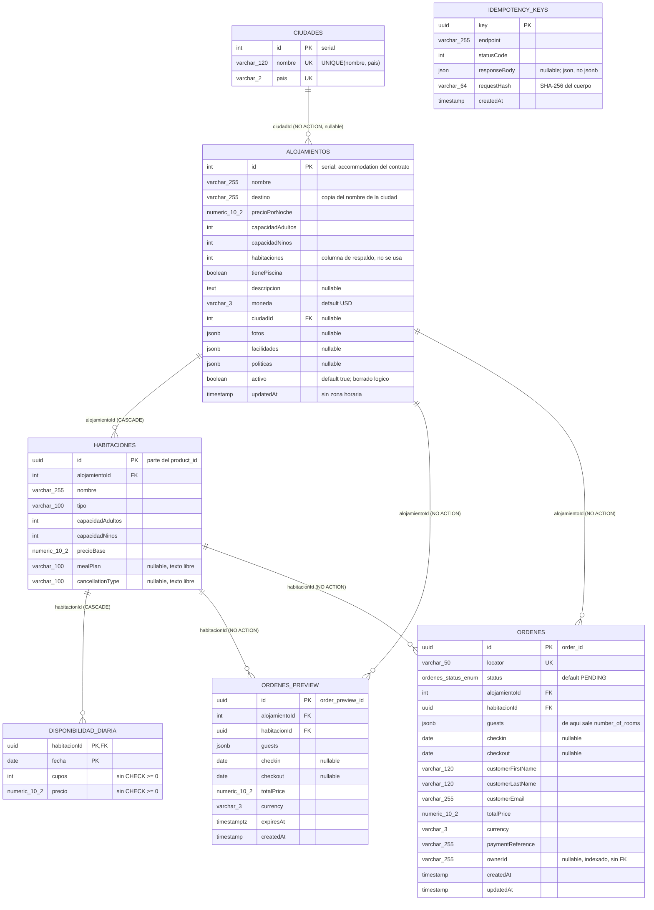
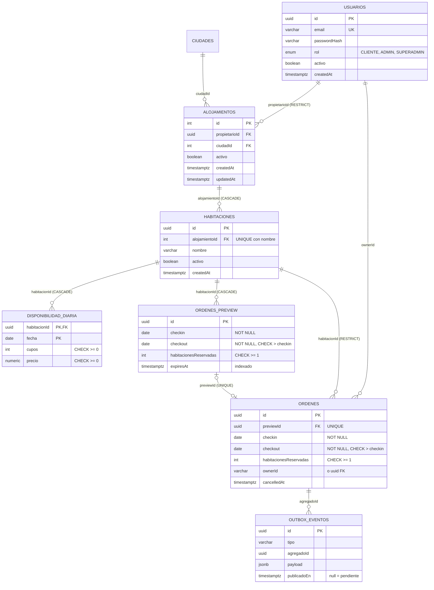

# Auditoría del modelo de datos — Alojamientos

Revisión del modelo de base de datos del módulo de alojamientos antes del paso 7 (admin de habitaciones y
disponibilidad) y del paso 8 (roles, login y propietario del alojamiento). Es un documento de **solo
lectura**: describe el modelo tal como está, evalúa su robustez y propone mejoras, pero no cambia nada.

## Estado tras el paso 7A

El paso 7A implementó el bloque imprescindible (sección 7.1). Las secciones 2 a 6 describen el modelo **antes**
de ese paso y se conservan como registro; el modelo vigente está en `docs/modelo-datos.md`.

| Hallazgo | Estado | Cómo se resolvió |
|---|---|---|
| A1 Sin migraciones | **Resuelto** | `synchronize: false` siempre; `src/database/data-source.ts`; migraciones `InitialSchema` (línea base) y `ModeloRobusto`; scripts `migration:generate`, `migration:run`, `migration:revert` y `migration:show` |
| A2 Sin CHECK | **Resuelto** | Checks en cupos, precios, totales, `checkout > checkin` y `habitacionesReservadas >= 1`. `ErroresBaseDatosFilter` traduce 23514, 23502, 23503 y 23505 a 400/409 problem+json |
| A3 Sin usuarios ni roles | Pendiente | Paso 8 |
| M1 Fechas nulas | **Resuelto** | `checkin` y `checkout` `NOT NULL` en órdenes y previews |
| M2 Habitaciones desde el JSON | **Resuelto** | Columna `ordenes.habitacionesReservadas`; la cancelación la usa |
| M3 Un preview, varias órdenes | **Resuelto** | `ordenes.previewId` con índice único y FK; el create bloquea el preview. Otra clave sobre un preview usado: 409 `ROOM_NO_LONGER_AVAILABLE` |
| M4 Sin índices en FKs | **Resuelto** | Índices en todas las FKs, `ordenes_preview.expiresAt`, `ordenes.createdAt` e `idempotency_keys.createdAt` |
| M5 ON DELETE y borrado de habitaciones | Parcial | `habitaciones.activo` (borrado lógico) y filtro en `/search`, `/availability`, `/details` y preview; un 23503 ya no es 500. Los `ON DELETE` no cambiaron (R2, paso 7B) |
| M6 Fechas de auditoría | Parcial | `createdAt` y `updatedAt` pasaron a `timestamptz`. Faltan columnas de auditoría en otras tablas (R3) |
| M7 a M9 | Pendientes | Bloque recomendable |

## 1. Alcance y cómo se verificó

| Fuente | Qué se revisó |
|---|---|
| Entidades | `src/modules/alojamientos/entities/*.ts` (7 entidades) |
| Configuración | `src/app.module.ts`, `src/common/transformers/column-numeric.transformer.ts`, `package.json` |
| Servicios | `ordenes.service.ts`, `disponibilidad.service.ts`, `alojamientos.service.ts`, `alojamientos-admin.service.ts` |
| Seed y documentación | `src/modules/alojamientos/seed/seed.ts`, `docs/modelo-datos.md` |
| Base real | Contenedor `booking_db_container`, base `booking_db`, PostgreSQL 16.15. Solo consultas de lectura a `information_schema`, `pg_constraint` y `pg_indexes` |

Las entidades de `atracciones`, `autos` y `vuelos` existen en el código, pero sus módulos están comentados en
`app.module.ts`, así que no tienen tablas en la base. Quedan fuera de esta auditoría.

**Lo que no se pudo verificar:** la configuración real del despliegue (si Render tendrá `NODE_ENV=production`),
el rendimiento con volúmenes grandes y si `cancel` y `create` pueden producir un *deadlock* entre sí bajo carga.
Eso último se razona en el hallazgo B7, pero no se probó.

## 2. Cómo se crea el esquema hoy

- No hay migraciones: no existe carpeta de migraciones ni scripts `migration:*` en `package.json`.
- El esquema lo crea TypeORM con `synchronize` (`src/app.module.ts:27`):
  `synchronize: NODE_ENV !== 'production'`. En desarrollo, al arrancar, TypeORM compara las entidades con la
  base y aplica los cambios (crea, altera y **borra** columnas). En producción no hace nada.
- `autoLoadEntities: true`: entra a la base toda entidad registrada con `TypeOrmModule.forFeature`.
- Extensión `uuid-ossp` instalada; los UUID se generan con `uuid_generate_v4()` en la base.
- El enum de estado se creó como tipo de PostgreSQL `ordenes_status_enum` = `{PENDING, CONFIRMED, CANCELLED}`.
- Zona horaria del servidor: `Etc/UTC`.
- Datos: `npm run seed` (3 ciudades, 5 alojamientos, 12 habitaciones, 720 filas de disponibilidad). Hoy las
  fechas van de 2026-10-05 a 2026-12-03, porque el seed parte de la fecha del día en que se ejecuta.

## 3. Comparación entidades contra base real

| Aspecto | Resultado |
|---|---|
| Tablas | 7 en la base, las mismas 7 entidades. Sin tablas sobrantes |
| Columnas | 65 columnas: nombre, tipo, largo, precisión y nulabilidad coinciden con las entidades |
| Claves primarias, foráneas y únicos | Coinciden con los decoradores |
| Índices | Solo los de las claves primarias, los únicos y `ordenes.ownerId`. TypeORM **no** crea índices para las claves foráneas, y PostgreSQL tampoco |
| Checks | Ninguno en la base. Las reglas (cupos ≥ 0, fechas, formatos) solo existen en los DTO y en el código |

`docs/modelo-datos.md` sí está desactualizado: dice que `idempotency_keys.responseBody` es `jsonb` (en la base
es `json`) y no menciona `requestHash` (`docs/modelo-datos.md:96-102`).

## 4. El modelo tal como está

### 4.1 Diagrama entidad-relación



`IDEMPOTENCY_KEYS` no tiene relaciones. En Mermaid, `varchar_120` significa `varchar(120)` y `numeric_10_2`
significa `numeric(10,2)`.

### 4.2 Detalle por tabla

#### `ciudades` (`ciudad.entity.ts`)

| Columna | Tipo | Nulo | Restricciones |
|---|---|---|---|
| id | integer (serial) | no | PK |
| nombre | varchar(120) | no | UNIQUE (nombre, pais) |
| pais | varchar(2) | no | UNIQUE (nombre, pais) |

Índices: PK y el único compuesto. Sin checks (el formato `^[a-z]{2}$` solo está en el DTO).

#### `alojamientos` (`alojamiento.entity.ts`)

| Columna | Tipo | Nulo | Restricciones |
|---|---|---|---|
| id | integer (serial) | no | PK |
| nombre | varchar(255) | no | — |
| destino | varchar(255) | no | — |
| precioPorNoche | numeric(10,2) | no | — |
| capacidadAdultos, capacidadNinos, habitaciones | integer | no | — |
| tienePiscina | boolean | no | — |
| descripcion | text | sí | — |
| moneda | varchar(3) | no | default `'USD'` |
| ciudadId | integer | sí | FK → ciudades(id), ON DELETE NO ACTION |
| fotos, facilidades, politicas | jsonb | sí | — |
| activo | boolean | no | default `true` |
| updatedAt | timestamp sin zona | no | default `now()` |

Índices: solo la PK (no hay índice en `ciudadId`).

#### `habitaciones` (`habitacion.entity.ts`)

| Columna | Tipo | Nulo | Restricciones |
|---|---|---|---|
| id | uuid | no | PK, default `uuid_generate_v4()` |
| alojamientoId | integer | no | FK → alojamientos(id), ON DELETE CASCADE |
| nombre | varchar(255) | no | — |
| tipo | varchar(100) | no | — |
| capacidadAdultos, capacidadNinos | integer | no | — |
| precioBase | numeric(10,2) | no | — |
| mealPlan, cancellationType | varchar(100) | sí | — |

Índices: solo la PK (no hay índice en `alojamientoId`, que se filtra en cada búsqueda).

#### `disponibilidad_diaria` (`disponibilidad-diaria.entity.ts`)

| Columna | Tipo | Nulo | Restricciones |
|---|---|---|---|
| habitacionId | uuid | no | PK (1.ª parte), FK → habitaciones(id), ON DELETE CASCADE |
| fecha | date | no | PK (2.ª parte) |
| cupos | integer | no | — |
| precio | numeric(10,2) | no | — |

Índices: la PK `(habitacionId, fecha)`, que sirve para las consultas por rango de fechas de una habitación.

#### `ordenes_preview` (`orden-preview.entity.ts`)

| Columna | Tipo | Nulo | Restricciones |
|---|---|---|---|
| id | uuid | no | PK |
| alojamientoId | integer | no | FK → alojamientos(id), NO ACTION |
| habitacionId | uuid | no | FK → habitaciones(id), NO ACTION |
| guests | jsonb | no | — |
| checkin, checkout | date | **sí** | — |
| totalPrice | numeric(10,2) | no | — |
| currency | varchar(3) | no | — |
| expiresAt | timestamptz | no | — |
| createdAt | timestamp sin zona | no | default `now()` |

Índices: solo la PK.

#### `ordenes` (`orden.entity.ts`)

| Columna | Tipo | Nulo | Restricciones |
|---|---|---|---|
| id | uuid | no | PK |
| locator | varchar(50) | no | UNIQUE |
| status | enum `ordenes_status_enum` | no | default `'PENDING'` |
| alojamientoId | integer | no | FK → alojamientos(id), NO ACTION |
| habitacionId | uuid | no | FK → habitaciones(id), NO ACTION |
| guests | jsonb | no | — |
| checkin, checkout | date | **sí** | — |
| customerFirstName, customerLastName | varchar(120) | no | — |
| customerEmail | varchar(255) | no | — |
| totalPrice | numeric(10,2) | no | — |
| currency | varchar(3) | no | — |
| paymentReference | varchar(255) | no | — |
| ownerId | varchar(255) | sí | índice simple, sin FK |
| createdAt, updatedAt | timestamp sin zona | no | default `now()` |

Índices: PK, único de `locator` e índice de `ownerId`.

#### `idempotency_keys` (`idempotency-key.entity.ts`)

| Columna | Tipo | Nulo | Restricciones |
|---|---|---|---|
| key | uuid | no | PK |
| endpoint | varchar(255) | no | — |
| statusCode | integer | no | — |
| responseBody | json | sí | — |
| requestHash | varchar(64) | no | — |
| createdAt | timestamp sin zona | no | default `now()` |

Índices: solo la PK.

## 5. Para qué existe cada tabla y qué decisiones tiene

**`ciudades`.** Catálogo pequeño para filtrar por `city` (entero) y `country` (2 letras) en `/search` y
`/details`. El único `(nombre, pais)` evita duplicados como "Quito, ec" dos veces.

**`alojamientos`.** Es el hotel. Su `id` es **entero autoincremental** porque el contrato define
`accommodation` y `accommodation_id` como `integer`. Guarda la ficha que devuelve `/details` (descripción,
fotos, facilidades y políticas en `jsonb`, porque el contrato las trata como objetos libres y no hay que
consultarlas por dentro). `activo` es el borrado lógico: el admin no borra filas, las desactiva, y las rutas
del contrato tratan un alojamiento inactivo como inexistente. Algunas columnas vienen de la plantilla y hoy
están de más: `habitaciones` (el número real se calcula contando filas), `destino` (copia del nombre de la
ciudad), y `precioPorNoche` y las capacidades (resumen de las habitaciones).

**`habitaciones`.** Es el *producto* que se vende. Su `id` es **UUID**, porque forma parte del `product_id`,
que en el contrato es texto (`<uuid>:<checkin>:<checkout>`). Un UUID no se puede adivinar ni recorrer, a
diferencia de un entero. Tiene la capacidad que usa el filtro de huéspedes y el `cancellationType`, que se
muestra en `/availability` y en la orden.

**`disponibilidad_diaria`.** El inventario: una fila por habitación y por noche, con los cupos que quedan y el
precio de esa noche. La clave `(habitacionId, fecha)` impide dos filas para la misma noche y, como índice,
hace rápidas las consultas por rango de fechas. Las tres rutas de venta dependen de ella:
- `/search` y `/availability`: una habitación está disponible si hay una fila para **cada** noche de
  `[checkin, checkout)` con `cupos >= habitaciones pedidas` (`COUNT(*) = noches`). El precio es `SUM(precio)`.
- `create`: dentro de una transacción hace `SELECT ... FOR UPDATE` de esas noches, en orden de fecha
  (`disponibilidad.service.ts:119-128`). Es un **bloqueo pesimista**: si dos clientes compran el último cupo
  a la vez, el segundo espera a que termine el primero, luego ya no ve cupo y recibe 409. Se eligió pesimista
  (y no optimista con versión) porque el conflicto se da justo en las fechas más demandadas, y reintentar
  sería peor. Bloquear en orden de fecha evita que dos transacciones se esperen en cruz.
- `cancel`: suma los cupos de vuelta (`disponibilidad.service.ts:147-155`).

**`ordenes_preview`.** La cotización: guarda habitación, fechas, huéspedes y precio durante 15 minutos
(`expiresAt` con zona horaria). Su `id` es el `order_preview_id`. No descuenta cupos: es una foto del precio
que `create` vuelve a comprobar (si cambió, 409 `PRICE_CHANGED`).

**`ordenes`.** La reserva confirmada. `id` UUID (`order_id` del contrato es `uuid`). `locator` es el código
de 8 caracteres para el cliente, con único en la base. `status` es un enum de PostgreSQL con los mismos tres
valores del contrato. Los datos del cliente, huéspedes, precio y moneda se copian dentro de la orden: es una
**foto** de lo que se vendió, y no debe cambiar si mañana cambia el precio o el nombre de la habitación.
`ownerId` queda listo para el `sub` del JWT, pero hoy siempre es `null`.

**`idempotency_keys`.** Garantiza que reintentar `create` con la misma `Idempotency-Key` no cree dos reservas.
Se guarda **en la misma transacción** que la orden, así que o se guardan las dos o ninguna. `requestHash`
(SHA-256 del cuerpo con las claves ordenadas) detecta la misma clave con otro cuerpo (422). `responseBody`
es `json` y no `jsonb` a propósito: `jsonb` reordena las claves, y el reintento debe devolver exactamente el
mismo JSON.

### Cómo sirven al flujo

| Paso | Tablas que lee | Tablas que escribe |
|---|---|---|
| `POST /orders/preview` | alojamientos, habitaciones, disponibilidad_diaria | ordenes_preview |
| `POST /orders/create` | idempotency_keys, ordenes_preview, alojamientos, disponibilidad_diaria (FOR UPDATE) | disponibilidad_diaria (resta cupos), ordenes, idempotency_keys |
| `GET /orders/{id}` | ordenes + alojamientos + habitaciones | — |
| `POST /orders/{id}/cancel` | ordenes (FOR UPDATE) | disponibilidad_diaria (suma cupos), ordenes (status) |

## 6. Hallazgos

Severidad: **alta** = puede corromper datos o impedir el despliegue; **media** = debilidad real que conviene
corregir antes de los pasos 7 y 8; **baja** = mejora de calidad o de mantenimiento.

### Altos

| # | Hallazgo | Dónde | Por qué importa |
|---|---|---|---|
| A1 | El esquema depende de `synchronize` y no hay migraciones | `src/app.module.ts:27` | Con `NODE_ENV=production`, `synchronize` queda en `false` y no hay migraciones: **una base nueva de producción quedaría sin tablas**. Con `synchronize` encendido (desarrollo, o producción sin esa variable), renombrar un campo de una entidad hace que TypeORM borre la columna y cree otra: **se pierden datos**. No hay historial versionado de los cambios del esquema |
| A2 | La base no tiene ningún `CHECK` | todas las entidades; p. ej. `disponibilidad-diaria.entity.ts:19-27` | Nada impide `cupos < 0`, `precio < 0`, `checkout <= checkin`, capacidades negativas o una moneda como `"usd1"`. Hoy lo protege el código (`descontarCupos` filtra `cupos >= cantidad`), pero el paso 7 escribirá cupos y precios desde el admin: un error de código o un `UPDATE` manual puede dejar cupos negativos, es decir, sobreventa |
| A3 | No hay usuarios, roles ni propietario del alojamiento | `orden.entity.ts:80-83`; `alojamiento.entity.ts` sin columna de propietario | `ownerId` es un `varchar` sin FK y siempre `null`. Los alojamientos no tienen dueño. El paso 8 no se puede hacer sin estas tablas, y hasta entonces cualquiera que conozca un `order_id` puede verla y cancelarla |

### Medios

| # | Hallazgo | Dónde | Por qué importa |
|---|---|---|---|
| M1 | `checkin` y `checkout` admiten `NULL` en órdenes y previews | `orden.entity.ts:52-56`, `orden-preview.entity.ts:36-40` | Quedaron así al agregar las columnas en el paso 6. Una orden sin fechas al cancelarse haría un `UPDATE` sobre 0 noches **sin error**: la orden pasaría a CANCELLED sin devolver los cupos |
| M2 | Las habitaciones reservadas se leen del `jsonb` `guests` | `ordenes.service.ts:261-262`, `ordenes.service.ts:280,295` | El número de cupos a devolver al cancelar sale de `guests.number_of_rooms`, dentro de un JSON que la base no valida. Si ese JSON cambia (una futura `modify`, una corrección manual), cancelar devuelve una cantidad distinta de la que se descontó |
| M3 | Una misma vista previa puede generar varias órdenes | `ordenes.service.ts:139-149`, `orden.entity.ts` (no guarda el preview) | `create` no marca el preview como usado y `ordenes` no guarda de qué preview salió. Con dos `Idempotency-Key` distintas y el mismo `order_preview_id`, se crean dos reservas (cada una descuenta cupos: no hay sobreventa, pero sí reservas duplicadas) |
| M4 | No hay índices en las claves foráneas | `habitacion.entity.ts:11-16`, `orden.entity.ts:35-47`, `orden-preview.entity.ts:19-31`, `alojamiento.entity.ts:50-55` | `habitaciones.alojamientoId` se filtra en cada `/search` y `/availability`. Con pocos datos no se nota, pero crece mal. Sin índice en `ordenes.habitacionId`, el paso 7 tendrá que recorrer toda la tabla para saber si una habitación tiene reservas futuras |
| M5 | `ON DELETE` no está pensado para el admin de habitaciones | FKs de `ordenes` y `ordenes_preview` (NO ACTION); `disponibilidad_diaria` (CASCADE) | Borrar físicamente una habitación con órdenes **o con previews viejos** falla con error 23503 (hoy saldría como 500). Como los previews nunca se borran, cualquier habitación cotizada alguna vez queda imposible de borrar. Y si no tiene órdenes, el CASCADE borra en silencio todo su inventario. `habitaciones` no tiene `activo` para el borrado lógico |
| M6 | Las fechas de auditoría no tienen zona horaria y faltan en varias tablas | `createdAt`/`updatedAt` en `orden.entity.ts:85-89`, `orden-preview.entity.ts:55`, `idempotency-key.entity.ts:24`, `alojamiento.entity.ts:69` | Son `timestamp without time zone`, mientras `expiresAt` es `timestamptz`. Funciona porque el servidor está en UTC, pero si cambia la zona del servidor las horas se corren. `alojamientos` no tiene `createdAt`; `habitaciones`, `ciudades` y `disponibilidad_diaria` no tienen ninguna fecha; nadie registra quién cambió qué (necesario cuando haya roles) |
| M7 | Previews y claves de idempotencia nunca se limpian | `orden-preview.entity.ts`, `idempotency-key.entity.ts` | Crecen sin límite. Los previews vencidos además bloquean borrar habitaciones (M5). No hay índice por `expiresAt` ni por `createdAt` para borrarlos rápido |
| M8 | La clave de idempotencia es global, no por cliente | `idempotency-key.entity.ts:6-7` | La PK es solo `key`. Cuando haya varios clientes (paso 8), conviene que la clave sea única por cliente y endpoint, para que la clave de un cliente no choque con la de otro ni pueda devolverle su respuesta |
| M9 | No hay tabla de eventos (*outbox*) | — | El contrato tiene webhooks y la materia pide arquitectura orientada a eventos (semana 6). Sin *outbox*, publicar "orden creada" después del commit puede perder eventos o publicar eventos de transacciones que se deshicieron |

### Bajos

| # | Hallazgo | Dónde |
|---|---|---|
| B1 | Columnas de la plantilla que duplican datos: `alojamientos.habitaciones` (el admin guarda 0 y el seed el conteo real; nadie la lee), `destino` (copia de la ciudad), `precioPorNoche` y capacidades (resumen de las habitaciones) | `alojamiento.entity.ts:21-38`, `alojamientos-admin.service.ts:101` |
| B2 | No hay único `(alojamientoId, nombre)` en `habitaciones` ni único de `nombre` en `alojamientos`, aunque el seed los usa como clave natural para no duplicar | `habitacion.entity.ts`, `seed.ts:139,162` |
| B3 | `mealPlan`, `cancellationType`, `facilidades`, `fotos` y `politicas` son texto libre o `jsonb` sin catálogo: no hay de dónde servir `/constants` ni forma de impedir valores inconsistentes | `habitacion.entity.ts:37-41`, `alojamiento.entity.ts:57-64` |
| B4 | El estado es un enum de PostgreSQL: agregar un valor requiere `ALTER TYPE`; `PENDING` nunca se usa; no se guarda `cancelledAt` ni el historial de cambios de estado | `orden.entity.ts:16-33` |
| B5 | El cliente y los huéspedes viven dentro de la orden. Es aceptable como foto de la venta, pero no hay forma de listar las reservas de un cliente sin `ownerId` | `orden.entity.ts:49-65` |
| B6 | El pago solo guarda `paymentReference`, sin estado ni monto. El contrato dice que los pagos son de otro dominio, así que está bien, salvo que el profesor pida más | `orden.entity.ts:77-78` |
| B7 | `cancel` hace el `UPDATE` de las noches sin `ORDER BY` (PostgreSQL no lo permite en `UPDATE`); `create` las bloquea en orden de fecha. Lo normal es que usen el mismo orden (el del índice de la PK), así que el riesgo de *deadlock* es bajo, pero no está garantizado. **No se probó** | `disponibilidad.service.ts:147-155` |
| B8 | `ColumnNumericTransformer` convierte `numeric` a `number` de JavaScript con `parseFloat`; el redondeo de `precioOrden` también es en coma flotante. Con dos decimales y montos chicos no falla, pero no es dinero exacto | `column-numeric.transformer.ts:8`, `alojamientos-consulta.utils.ts:80-82` |
| B9 | `locator` es `varchar(50)` para un código de 8 caracteres, sin check de formato | `orden.entity.ts:29-30` |
| B10 | No hay moneda por noche: `disponibilidad_diaria.precio` asume la moneda del alojamiento | `disponibilidad-diaria.entity.ts:22-27` |
| B11 | El seed depende de la fecha del día: no es reproducible y al repetirlo agrega días | `seed.ts:108-117` |
| B12 | `docs/modelo-datos.md` está desactualizado (`responseBody` como `jsonb`, falta `requestHash`) | `docs/modelo-datos.md:96-102` |

### Lo que está bien y conviene defender

- La PK `(habitacionId, fecha)` hace imposible tener dos filas de inventario para la misma noche.
- `create` es todo o nada: cupos, orden y clave de idempotencia se guardan en la misma transacción.
- Bloqueo pesimista en orden de fecha y verificación `affected === noches` al descontar.
- `cancel` bloquea la orden y no devuelve cupos dos veces.
- Dinero en `numeric(10,2)`, nunca en `float`. Fechas de estancia en `date`, sin hora.
- Ids enteros donde el contrato pide `integer`; UUID donde el id sale al exterior y no debe adivinarse.
- La orden guarda una foto de precio, cliente y huéspedes.

## 7. Modelo mejorado propuesto

No se implementa aquí. Los nombres siguen el estilo actual (camelCase entre comillas en SQL, tablas en
plural y en español).

### 7.1 Bloque imprescindible (antes de desplegar)

**I1. Migraciones en lugar de `synchronize`** (resuelve A1)
- Crear `src/database/data-source.ts` (un `DataSource` de TypeORM que lea `DATABASE_URL`) y la carpeta
  `src/database/migrations/`.
- Scripts: `migration:generate`, `migration:run` y `migration:revert` con el CLI de TypeORM.
- `synchronize: false` siempre; `migrationsRun: true` o ejecutar `migration:run` antes de arrancar en Render.
- Primera migración: la **línea base**, generada contra una base vacía; debe producir exactamente el esquema
  actual. Las siguientes migraciones aplican I2 a I7.

**I2. Checks en la base** (resuelve A2)

```sql
ALTER TABLE disponibilidad_diaria
  ADD CONSTRAINT ck_disp_cupos  CHECK (cupos >= 0),
  ADD CONSTRAINT ck_disp_precio CHECK (precio >= 0);

ALTER TABLE habitaciones
  ADD CONSTRAINT ck_hab_adultos CHECK ("capacidadAdultos" >= 1),
  ADD CONSTRAINT ck_hab_ninos   CHECK ("capacidadNinos" >= 0),
  ADD CONSTRAINT ck_hab_precio  CHECK ("precioBase" >= 0);

ALTER TABLE alojamientos
  ADD CONSTRAINT ck_aloj_moneda CHECK (moneda ~ '^[A-Z]{3}$'),
  ADD CONSTRAINT ck_aloj_precio CHECK ("precioPorNoche" >= 0);

ALTER TABLE ciudades ADD CONSTRAINT ck_ciudad_pais CHECK (pais ~ '^[a-z]{2}$');

ALTER TABLE ordenes
  ADD CONSTRAINT ck_orden_fechas CHECK (checkout > checkin),
  ADD CONSTRAINT ck_orden_total  CHECK ("totalPrice" >= 0),
  ADD CONSTRAINT ck_orden_moneda CHECK (currency ~ '^[A-Z]{3}$');

ALTER TABLE ordenes_preview
  ADD CONSTRAINT ck_preview_fechas CHECK (checkout > checkin),
  ADD CONSTRAINT ck_preview_total  CHECK ("totalPrice" >= 0);
```

En TypeORM se declaran con `@Check(...)` en la entidad, para que la migración generada los incluya.

**I3. Fechas obligatorias** (resuelve M1): `checkin` y `checkout` `NOT NULL` en `ordenes` y `ordenes_preview`.
Primero se comprueba que no haya filas con `NULL` (hoy no hay ninguna orden ni preview).

**I4. Habitaciones reservadas como columna** (resuelve M2)

```sql
ALTER TABLE ordenes ADD COLUMN "habitacionesReservadas" int;
UPDATE ordenes SET "habitacionesReservadas" = (guests->>'number_of_rooms')::int;
ALTER TABLE ordenes ALTER COLUMN "habitacionesReservadas" SET NOT NULL,
  ADD CONSTRAINT ck_orden_habitaciones CHECK ("habitacionesReservadas" >= 1);
```
Lo mismo en `ordenes_preview`. `cancel` devuelve exactamente ese número.

**I5. Una orden por vista previa** (resuelve M3)

```sql
ALTER TABLE ordenes ADD COLUMN "previewId" uuid
  REFERENCES ordenes_preview(id) ON DELETE SET NULL;
CREATE UNIQUE INDEX uq_ordenes_preview ON ordenes("previewId") WHERE "previewId" IS NOT NULL;
```
Un segundo `create` con el mismo preview y otra clave responde 409 `ROOM_NO_LONGER_AVAILABLE` ("la vista
previa ya se usó"), en problem+json. Con la misma clave sigue devolviendo la respuesta guardada, como hoy.
(Implementado en el paso 7A como índice único `UQ_ordenes_previewId`; se eligió 409 en lugar del 400 que
proponía esta sección.)

**I6. Índices para las consultas reales** (resuelve M4)

```sql
CREATE INDEX ix_habitaciones_alojamiento ON habitaciones("alojamientoId");
CREATE INDEX ix_alojamientos_ciudad      ON alojamientos("ciudadId");
CREATE INDEX ix_ordenes_habitacion_fecha ON ordenes("habitacionId", checkin);
CREATE INDEX ix_ordenes_alojamiento      ON ordenes("alojamientoId");
CREATE INDEX ix_preview_expira           ON ordenes_preview("expiresAt");
CREATE INDEX ix_idem_creada              ON idempotency_keys("createdAt");
```

**I7. Fechas de auditoría con zona horaria** (resuelve parte de M6): `createdAt` y `updatedAt` como
`timestamptz` (`@CreateDateColumn({ type: 'timestamptz' })`). Con el servidor en UTC la conversión es directa:
`ALTER COLUMN ... TYPE timestamptz USING "createdAt" AT TIME ZONE 'UTC'`.

### 7.2 Bloque recomendable (antes o durante los pasos 7 y 8)

**R1. Usuarios, roles y propietario** (resuelve A3; base del paso 8)

```sql
CREATE TYPE usuarios_rol_enum AS ENUM ('CLIENTE', 'ADMIN', 'SUPERADMIN');
CREATE TABLE usuarios (
  id             uuid PRIMARY KEY DEFAULT uuid_generate_v4(),
  email          varchar(255) NOT NULL,
  "passwordHash" varchar(255) NOT NULL,
  nombre         varchar(120) NOT NULL,
  rol            usuarios_rol_enum NOT NULL DEFAULT 'CLIENTE',
  activo         boolean NOT NULL DEFAULT true,
  "createdAt"    timestamptz NOT NULL DEFAULT now(),
  "updatedAt"    timestamptz NOT NULL DEFAULT now()
);
CREATE UNIQUE INDEX uq_usuarios_email ON usuarios (lower(email));

ALTER TABLE alojamientos ADD COLUMN "propietarioId" uuid
  REFERENCES usuarios(id) ON DELETE RESTRICT;          -- el ADMIN dueño del alojamiento
CREATE INDEX ix_alojamientos_propietario ON alojamientos("propietarioId");
```
- **Cliente** reserva y ve sus órdenes; **admin** administra sus alojamientos (`propietarioId = sub`);
  **superadmin** administra todo.
- Un rol por usuario (enum) alcanza para tres roles fijos. Una tabla `usuario_roles` solo haría falta si un
  usuario pudiera tener varios roles.
- `ordenes.ownerId` pasa a ser `uuid` con FK a `usuarios(id)` si el JWT lo emite este mismo sistema. Si el
  token viene de un proveedor externo, se queda como texto (el `sub` externo) y solo se indexa. **Esto lo
  tiene que decidir el profesor.**

**R2. Habitaciones para el paso 7** (resuelve M5)
- `habitaciones.activo boolean NOT NULL DEFAULT true` (borrado lógico, como en alojamientos).
- Único `(alojamientoId, nombre)` (B2).
- FKs de `ordenes` hacia `habitaciones` y `alojamientos` con `ON DELETE RESTRICT` explícito; FKs de
  `ordenes_preview` con `ON DELETE CASCADE` (los previews son desechables).
- `disponibilidad_diaria` sigue en CASCADE, pero el admin solo hace borrado lógico de la habitación.

**R3. Auditoría** (resto de M6)
- `createdAt` y `updatedAt` en `alojamientos`, `habitaciones`, `ciudades` y `disponibilidad_diaria`.
- `createdBy` y `updatedBy` (`uuid`, FK a usuarios) en las tablas que edita el admin.
- `ordenes.cancelledAt timestamptz` y, si se quiere historial, una tabla `orden_estados (ordenId, de, a, en, por)`.

**R4. Limpieza programada** (resuelve M7): un job con `@nestjs/schedule` (o `pg_cron`) que borre los previews
vencidos hace más de 1 día que no tengan orden, y las claves de idempotencia de más de 24 horas, usando los
índices de I6. Si se quiere un plazo explícito, se agrega `idempotency_keys.expiresAt`.

**R5. Idempotencia por cliente** (resuelve M8): PK `(ownerId, endpoint, key)` o único equivalente, cuando
exista `ownerId`. Mientras no haya usuarios, se queda como está.

**R6. Outbox de eventos** (resuelve M9)

```sql
CREATE TABLE outbox_eventos (
  id             uuid PRIMARY KEY DEFAULT uuid_generate_v4(),
  tipo           varchar(100) NOT NULL,        -- 'orden.creada', 'orden.cancelada'
  "agregadoId"   uuid NOT NULL,                -- id de la orden
  payload        jsonb NOT NULL,
  "createdAt"    timestamptz NOT NULL DEFAULT now(),
  "publicadoEn"  timestamptz
);
CREATE INDEX ix_outbox_pendientes ON outbox_eventos("createdAt") WHERE "publicadoEn" IS NULL;
```
Se inserta en la misma transacción que la orden. Un proceso aparte lee los pendientes, los publica (webhooks
o cola) y marca `publicadoEn`.

**R7. Limpiar columnas de la plantilla** (B1): dejar de escribir `alojamientos.habitaciones` y `destino`, y
borrarlas después con una migración (patrón *expand/contract*). No se exponen en el contrato.

### 7.3 Bloque opcional

- **Catálogos** (B3): `comodidades` + `alojamiento_comodidades` (N:M), `fotos_alojamiento (alojamientoId,
  url, orden)`, `politicas_cancelacion (codigo, descripcion, horasLimite, porcentajeReembolso)` referenciada
  desde `habitaciones.cancellationType`, y `planes_comida`. Con eso `/constants` sale de datos reales.
- **Tarifas**: `planes_tarifa (id, habitacionId, nombre, reembolsable)` y disponibilidad por plan; moneda por
  noche (B10).
- **Clientes y huéspedes normalizados**: tabla `huespedes_orden`, solo si el contrato llega a pedir nombres de
  huéspedes.
- **Pagos**: tabla `pagos (ordenId, referencia, estado, monto, moneda)`, solo si el profesor lo pide (el
  contrato lo deja a otro dominio).
- **Cadenas y reseñas**: `cadenas`, `marcas` y `resenas`, para las rutas de relleno `/chains` y `/reviews`.
- **Estado como `varchar` + `CHECK`** en lugar de enum de PostgreSQL (B4), si se prevén estados nuevos.
- **Seed reproducible** (B11): fecha inicial fija o tomada de una variable de entorno.

### 7.4 Diagrama del modelo propuesto (imprescindible + recomendable)



## 8. Impacto en los endpoints actuales

| Cambio | Impacto en el contrato | Impacto en el código |
|---|---|---|
| I1 Migraciones | Ninguno | `app.module.ts`, nuevo `data-source.ts`, scripts en `package.json`, paso de despliegue |
| I2 Checks | Ninguno: los DTO ya rechazan esos valores con 400 | El filtro de errores debe traducir el código 23514 (check) a 400 y no a 500 |
| I3 Fechas NOT NULL | Ninguno | Las entidades dejan de ser `string \| null`; desaparece la comprobación `!preview.checkin` |
| I4 habitacionesReservadas | Ninguno: la respuesta sigue mostrando `rooms` | preview y create la guardan; cancel la usa en lugar de `guests` |
| I5 Una orden por preview | Mismas rutas y códigos; un caso nuevo de 409 | create guarda `previewId` y traduce el 23505 de ese índice |
| I6 Índices | Ninguno | Ninguno |
| I7 timestamptz | Ninguno: `creation_date` ya se envía en ISO UTC | Solo las entidades |
| R1 Usuarios y roles | El contrato ya define OAuth2 y `ownerId`: se empieza a cumplir | Paso 8: login, guards, filtro por propietario en el admin y por dueño en las órdenes |
| R2 Habitaciones | Ninguno | Paso 7: el admin de habitaciones usa borrado lógico; las rutas del contrato ignoran las inactivas |
| R6 Outbox | Habilita los webhooks del contrato | create y cancel insertan el evento en su transacción |

Ningún cambio agrega o quita campos de las rutas del contrato.

## 9. Cómo migrar sin romper el contrato

1. **Línea base.** Generar la primera migración contra una base vacía y comprobar que crea exactamente las 7
   tablas actuales. En desarrollo: recrear la base, `migration:run` y `npm run seed`. En una base con datos que
   ya tiene el esquema, se registra la línea base como aplicada sin ejecutarla.
2. **Apagar `synchronize`** en todos los entornos.
3. **Cambios que solo amplían** (*expand*): columnas nuevas como `NULL`, rellenarlas con un `UPDATE` y recién
   después ponerlas `NOT NULL` (I3, I4, I5, R1).
4. **Checks sin bloquear la tabla:** `ADD CONSTRAINT ... NOT VALID` y luego `VALIDATE CONSTRAINT`. Si la
   validación falla, primero se corrigen los datos.
5. **Índices en tablas grandes:** `CREATE INDEX CONCURRENTLY`, en una migración con `transaction = false`.
6. **Quitar columnas** (*contract*) solo cuando el código ya no las lee ni las escribe (R7), en una versión
   posterior.
7. **Probar cada migración con `migration:revert`** y repetir las pruebas del flujo (preview, create con
   idempotencia, concurrencia por el último cupo, cancel), comparando la huella de `disponibilidad_diaria`
   antes y después.

## 10. Dudas para el profesor

1. ¿El JWT lo emitimos nosotros (tabla `usuarios` propia y `ownerId` como FK) o viene de otro servicio (solo
   guardamos el `sub`)?
2. ¿Un usuario puede tener más de un rol, o basta con un rol por usuario?
3. ¿Un alojamiento puede tener varios propietarios o administradores?
4. ¿Hace falta registrar pagos en nuestra base, o basta con `paymentReference`?
5. ¿Se espera la tabla *outbox* en este proyecto o en la entrega de la semana 6?
