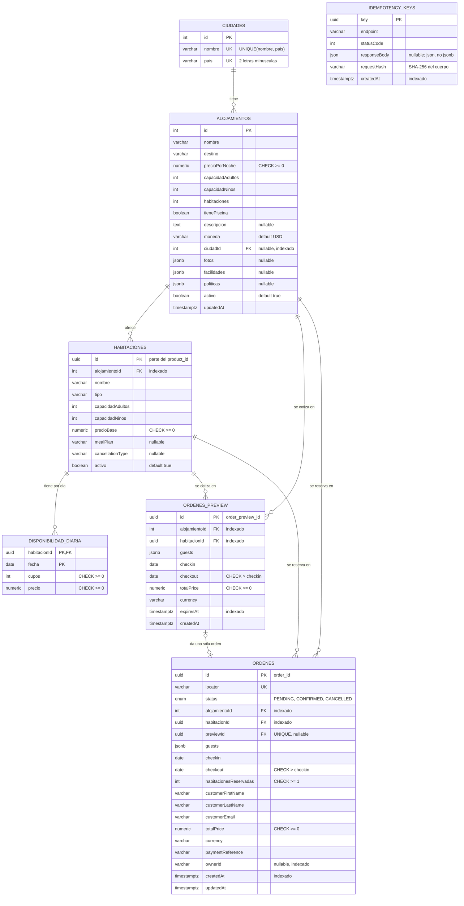

# Modelo de datos — Alojamientos

Modelo para el flujo de venta: **buscar, ver, reservar y cancelar**, basado en
`contracts/alojamientos-openapi.yaml`. Las entidades están en `src/modules/alojamientos/entities/` y el
esquema lo crean las migraciones de `src/database/migrations/`.

## Cómo se crea el esquema (migraciones)

`synchronize` está **apagado siempre**, también en desarrollo: TypeORM ya no modifica la base al arrancar.
El esquema solo cambia con migraciones versionadas en git.

| Comando | Qué hace |
|---|---|
| `npm run migration:run` | Aplica las migraciones pendientes (compila antes con `nest build`) |
| `npm run migration:revert` | Deshace la última migración aplicada |
| `npm run migration:show` | Lista las migraciones y marca con `[X]` las aplicadas |
| `npm run migration:generate -- src/database/migrations/Nombre` | Genera una migración comparando las entidades con la base |

- El CLI usa `src/database/data-source.ts` (ya compilado en `dist/`) y lee `DATABASE_URL` del entorno o de `.env`.
- Las migraciones aplicadas se registran en la tabla `migraciones`.
- Revisar siempre una migración generada antes de aplicarla: para cambiar el tipo de una columna, TypeORM la
  borra y la crea de nuevo, y eso pierde los datos. En ese caso hay que escribir `ALTER COLUMN ... TYPE ... USING`.

| Migración | Contenido |
|---|---|
| `1791950472576-InitialSchema` | Línea base: las 7 tablas tal como las dejaba `synchronize` hasta el paso 6, y la extensión `uuid-ossp` |
| `1791950700000-ModeloRobusto` | Paso 7A: checks, fechas obligatorias, `habitacionesReservadas`, `previewId`, índices, `timestamptz` y `habitaciones.activo` |

Base nueva desde cero:

```bash
docker-compose up -d
npm run migration:run
npm run seed
```

## Diagrama



`IDEMPOTENCY_KEYS` no tiene relaciones: es una tabla de apoyo independiente.

## Las 7 tablas

| Tabla | Para qué sirve |
|---|---|
| `ciudades` | Catálogo de ciudades. El contrato filtra por `city` (entero) y `country` (2 letras minúsculas). |
| `alojamientos` | El hotel o lugar donde se hospeda el cliente. Su `id` es **entero**, como pide el contrato (`accommodation: integer`). Guarda los datos que devuelven `/search` y `/details` (descripción, fotos, facilidades, políticas). `activo` es su borrado lógico. |
| `habitaciones` | Cada tipo de habitación de un alojamiento. Es el *product* del contrato: su `id` (UUID) viaja dentro del `product_id`. `activo` es su borrado lógico: una habitación inactiva no aparece en `/search`, `/availability`, `/details` ni en el preview, pero sus órdenes se pueden consultar y cancelar. |
| `disponibilidad_diaria` | Una fila por habitación y por día, con los cupos que quedan y el precio de ese día. La clave primaria es `(habitacionId, fecha)`. De aquí salen `/availability` y el precio total de una estadía. |
| `ordenes_preview` | Cotización guardada antes de reservar. Su `id` es el `order_preview_id`, y `expiresAt` dice hasta cuándo se puede usar para crear la orden. |
| `ordenes` | La reserva. Su `id` (UUID) es el `order_id`, `locator` es el código de confirmación y `status` es `PENDING`, `CONFIRMED` o `CANCELLED`. Guarda los datos del cliente, el preview del que salió (`previewId`), las habitaciones reservadas y `ownerId`, que saldrá del JWT. |
| `idempotency_keys` | Guarda la respuesta de cada `Idempotency-Key`. Si el cliente reintenta con la misma clave, se devuelve exactamente lo mismo en lugar de crear otra reserva. |

## Restricciones

| Tabla | Restricción | Regla |
|---|---|---|
| `disponibilidad_diaria` | `CHK_disponibilidad_cupos`, `CHK_disponibilidad_precio` | `cupos >= 0`, `precio >= 0` |
| `habitaciones` | `CHK_habitaciones_precio_base` | `precioBase >= 0` |
| `alojamientos` | `CHK_alojamientos_precio_por_noche` | `precioPorNoche >= 0` |
| `ordenes` | `CHK_ordenes_total`, `CHK_ordenes_fechas`, `CHK_ordenes_habitaciones_reservadas` | `totalPrice >= 0`, `checkout > checkin`, `habitacionesReservadas >= 1` |
| `ordenes_preview` | `CHK_ordenes_preview_total`, `CHK_ordenes_preview_fechas` | `totalPrice >= 0`, `checkout > checkin` |
| `ordenes` | `UQ_ordenes_previewId` (índice único) | un preview da una sola orden |
| `ordenes` | `UNIQUE (locator)` | localizador irrepetible |
| `ciudades` | `UNIQUE (nombre, pais)` | sin ciudades repetidas |

`checkin` y `checkout` son obligatorios (`NOT NULL`) en órdenes y previews.

Si una restricción rechaza un dato que el código no validó antes, `ErroresBaseDatosFilter`
(`problems/errores-base-datos.filter.ts`) responde en `application/problem+json` y nunca con 500:

| Error de PostgreSQL | Respuesta |
|---|---|
| 23514 check | 400 `VALIDATION_FAILED`, con el campo en `invalidParams` |
| 23502 not null | 400 `VALIDATION_FAILED` |
| 23503 foreign key | 400 si apunta a algo que no existe; 409 si se borra algo que otro registro usa |
| 23505 unique | 409; si es `UQ_ordenes_previewId`, `ROOM_NO_LONGER_AVAILABLE` |

## Índices

- Claves foráneas: `IX_alojamientos_ciudadId`, `IX_habitaciones_alojamientoId`,
  `IX_ordenes_preview_alojamientoId`, `IX_ordenes_preview_habitacionId`, `IX_ordenes_alojamientoId`,
  `IX_ordenes_habitacionId` y `UQ_ordenes_previewId`. La clave foránea de `disponibilidad_diaria` la cubre su
  clave primaria `(habitacionId, fecha)`, que empieza por `habitacionId`.
- Para limpiar datos viejos: `IX_ordenes_preview_expiresAt`, `IX_idempotency_keys_createdAt`.
- Para listar órdenes: `IX_ordenes_createdAt` y el índice de `ownerId`.

## Decisiones

- **IDs:** alojamiento y ciudad usan entero autoincremental (el contrato los define como `integer`). Habitaciones, previews y órdenes usan UUID.
- **Fechas:** `checkin`, `checkout` y `fecha` son tipo `date` (sin hora). Las fechas de auditoría (`createdAt`, `updatedAt`, `expiresAt`) son `timestamptz`.
- **Dinero:** columnas `numeric(10,2)` con `ColumnNumericTransformer`, para recibir números y no texto.
- **Lo que queda fuera por ahora:** pagos, huéspedes como tabla aparte, reseñas, webhooks, cadenas hoteleras, usuarios y roles. Los datos del cliente van dentro de `ordenes`.
- **Borrado:** alojamientos y habitaciones tienen borrado lógico (`activo`). En la base, al borrar un alojamiento se borran sus habitaciones, y al borrar una habitación su disponibilidad (`ON DELETE CASCADE`); una habitación con órdenes no se puede borrar (409). Si se borra un preview, la orden conserva todo y su `previewId` queda en `NULL`.

## Cupos: cuándo se descuentan y cuándo se devuelven

- `POST /orders/preview` **no** toca los cupos: solo comprueba disponibilidad, calcula el precio y guarda la vista previa (vale 15 minutos).
- `POST /orders/create`, en **una transacción**:
  1. Bloquea la fila del preview (`SELECT ... FOR UPDATE`): dos creaciones sobre el mismo preview pasan de a una.
  2. Si mientras tanto terminó otra petición con la **misma** `Idempotency-Key`, devuelve su respuesta guardada.
  3. Si el preview ya dio una orden (con **otra** clave): `409 ROOM_NO_LONGER_AVAILABLE`, "la vista previa ya se usó".
  4. Bloquea las noches de `disponibilidad_diaria` en orden de fecha, vuelve a verificar cupos y precio, descuenta
     `habitacionesReservadas` cupos de cada noche, crea la orden (con `previewId` y `habitacionesReservadas`) y guarda la `Idempotency-Key`.

  Si algo falla, se deshace todo y no queda ningún cupo descontado. Dos reservas simultáneas por el último cupo: la segunda espera el bloqueo, ya no encuentra cupo y recibe `409 ROOM_NO_LONGER_AVAILABLE`.
- `POST /orders/{orderId}/cancel` devuelve, en una transacción y con la orden bloqueada, exactamente `habitacionesReservadas` cupos a cada noche y pasa la orden a `CANCELLED`. Cancelar una orden ya cancelada no devuelve cupos otra vez.

## Datos de prueba (seed)

```bash
npm run seed
```

Carga 3 ciudades, 5 alojamientos, 12 habitaciones y 60 días de disponibilidad por habitación (720 filas), desde la fecha del día. Se puede ejecutar varias veces: no duplica datos y solo agrega los días nuevos que falten. Necesita la base corriendo (`docker-compose up -d`) y las migraciones aplicadas (`npm run migration:run`).
